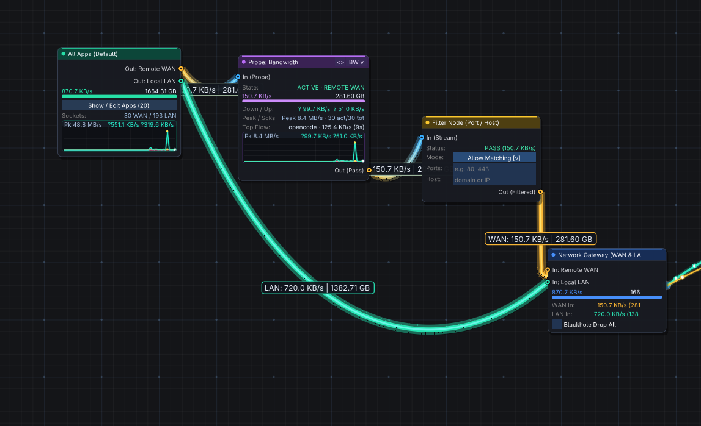
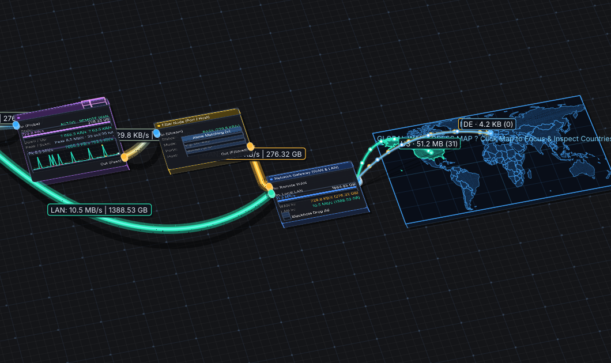
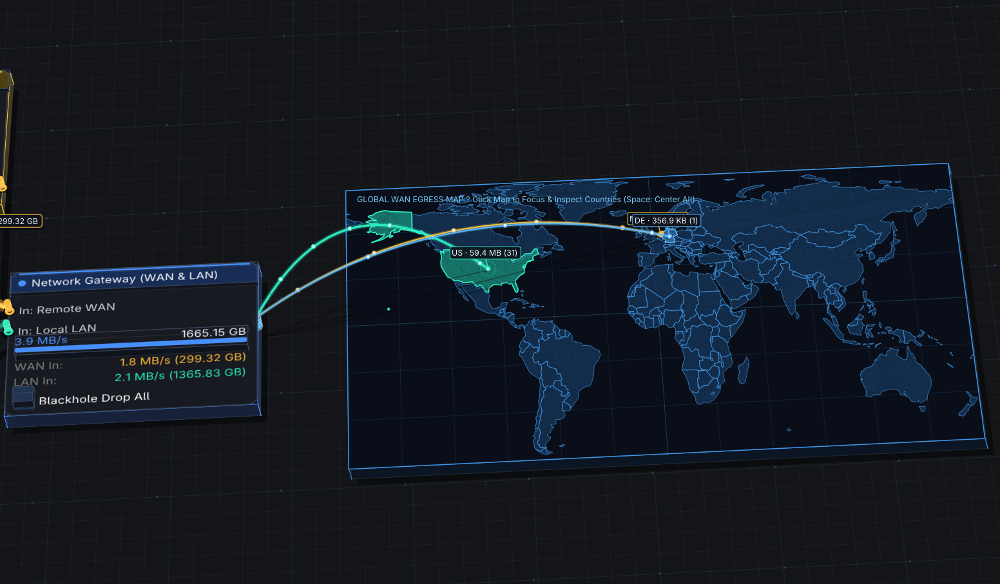

# WaterWall

Visual Linux firewall, per-application network inspector, and interactive node-graph traffic router built with **Rust** and a custom **Dear ImGui** engine.



<p align="center">
  
  
</p>

## Features

- **5 Integrated Views**:
  - **`[1] Usage`** — Traffic doughnut, country breakdown, grouped apps with native icons, hosts/ASN lookup, protocol badges, and timeline scrubber.
  - **`[2] Traffic Monitor`** — Multi-app real-time bandwidth waveforms and throughput breakdown.
  - **`[3] App Connections`** — Live socket inspector with 1-click **Allow / Block / Proxy / Send to Flow Graph** controls.
  - **`[4] Flow Graph`** — Verlet physics node editor with inline node-on-rope splicing, 3D isometric tilt, and an interactive Global WAN Egress Map.
  - **`[5] DNS & Alerts`** — Live reverse-DNS log and security anomaly alerts.
- **Graph Nodes**: `AppGroup` (WAN/LAN sources), `TrafficMonitor` (multi-mode inline probe), `FilterNode` (port/host rules), `BlockNode` (socket kill-switch), `VpnNode` (WireGuard/TUN), `ProxyNode` (SOCKS5/HTTP CONNECT), `RateLimiter` (QoS shaper), and `InternetGateway` (WAN/LAN sink).
- **Linux Networking Engine**: Maps `/proc/net/*` inodes to `/proc/[pid]/{fd,io}`, aborts blocked connections via Netlink `SOCK_DESTROY` / `ss -K`, and routes proxied streams via eBPF `cgroup/connect4` and local relays.

## Controls & Shortcuts

| Input | Action |
| :--- | :--- |
| **Drag node / Drop on rope** | Move node / Splice node inline into an existing connection |
| **Drag pin / Right-drag rope** | Connect pins / Cut links (severed ropes fall off canvas) |
| **Right-click canvas / header** | Spawn node or isolate app / Delete node |
| **Middle-drag / `Space`** | Pan canvas / Center all nodes |
| **Click World Map** | Focus map and click countries to filter traffic |
| **`Ctrl+Z` / `Ctrl+Y` / `Ctrl+S`** | Undo / Redo / Save graph & group rules |

## Project Layout

```text
WaterWall/
├── imgui/          # Custom Dear ImGui C++ fork (Verlet ropes, 3D tilt, world map)
├── vendor/         # Vendored `imgui` and `imgui-sys` crates with node graph FFI
└── src/
    ├── gui/        # 5-tab UI, node graph state, icons, flags, and custom widgets
    ├── net/        # procfs scanner, DNS/GeoIP, socket killer, eBPF & proxy relay
    └── utils/      # BPF loader, privilege elevation, parsers, and formatters
```

## Build & Run

Requires Rust (`cargo`), a C++11 compiler (`g++`/`clang++`), `pkg-config`, and OpenGL/X11/Wayland headers.

```sh
cargo run --release          # Launch GUI (prompts for optional sudo to inspect all PIDs)
cargo run -- --no-sudo       # Launch GUI monitoring current user processes only
cargo run -- --probe         # Print live network processes and sockets in terminal
cargo run -- --daemon        # Run privileged background daemon on /run/waterwall.sock
cargo test                   # Run unit & integration tests
```

## Credits & License

WaterWall is licensed under **MIT OR Apache-2.0**.

This repository bundles modified versions of:
- [**Dear ImGui**](https://github.com/ocornut/imgui) (`imgui/`) by Omar Cornut and contributors — licensed under the [MIT License](imgui/LICENSE.txt).
- [**imgui-rs**](https://github.com/imgui-rs/imgui-rs) (`vendor/imgui`, `vendor/imgui-sys`) by the `imgui-rs` developers — licensed under [MIT](vendor/imgui/LICENSE-MIT) / [Apache-2.0](vendor/imgui/LICENSE-APACHE).
- [**cimgui**](https://github.com/cimgui/cimgui) (`vendor/imgui-sys/third-party/`) by Stephan Dilly and contributors — licensed under the MIT License.
